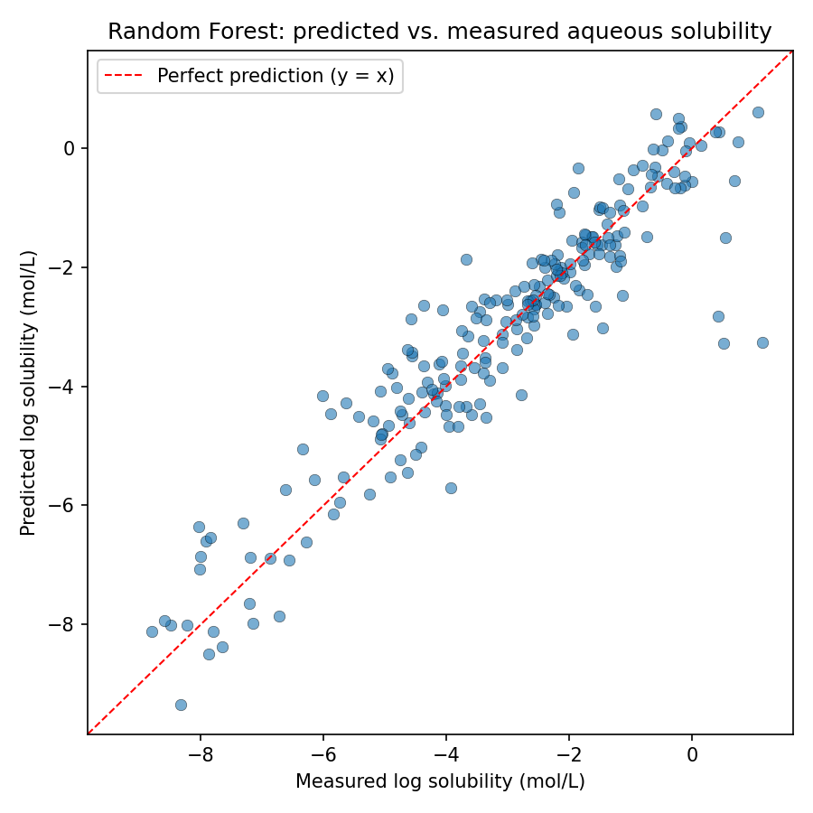

# Aqueous Solubility Prediction from Molecular Structure

Predicts how soluble a molecule is in water, directly from its SMILES
string, using simple RDKit descriptors and a Random Forest model.

Aqueous solubility is one of the first properties checked in early-stage
drug discovery — a molecule with poor solubility is hard to formulate and
poorly absorbed, no matter how well it binds its target. This project
reproduces a classic cheminformatics benchmark: predicting solubility from
2D molecular structure alone, no experimental data about the compound
other than its SMILES.

## Results

Trained and evaluated on a held-out 20% test set (226 molecules never
seen during training):

| Metric | Value |
|---|---|
| R² | 0.864 |
| RMSE | 0.803 log units |
| MAE | 0.558 log units |
| Train / test size | 902 / 226 molecules |



For context, the original ESOL paper (Delaney, 2004) reported an RMSE of
~0.9 log units with a hand-fit linear model on the same kind of
descriptors — this Random Forest is in the same range using an
out-of-the-box model with no hyperparameter tuning, which is expected and
is noted as a direction for improvement below, not claimed as
state-of-the-art.

**What drives the prediction.** Feature importances from the trained model:

| Descriptor | Importance |
|---|---|
| LogP (lipophilicity) | 0.824 |
| Molecular weight | 0.093 |
| TPSA (polar surface area) | 0.040 |
| Aromatic proportion | 0.012 |
| Ring count | 0.009 |
| Rotatable bonds | 0.008 |
| H-bond acceptors | 0.009 |
| H-bond donors | 0.005 |

This matches basic physical chemistry: lipophilicity dominates aqueous
solubility, which is the expected result and a reasonable sanity check
that the model learned something real rather than fitting noise.

## Dataset

[Delaney / ESOL dataset](https://pubs.acs.org/doi/10.1021/ci034243x)
(1,128 organic molecules with measured aqueous solubility), via the
[DeepChem](https://github.com/deepchem/deepchem) MoleculeNet collection.
Loaded from `data/delaney_raw.csv`.

## Method

1. **Featurization** (`src/featurize.py`) — for each molecule, RDKit
   computes 8 descriptors: molecular weight, LogP, H-bond donors/acceptors,
   topological polar surface area (TPSA), rotatable bonds, ring count, and
   aromatic proportion. These are the same descriptor families used in
   Lipinski's Rule of Five and the original ESOL paper.
2. **Model** (`src/train.py`) — `RandomForestRegressor` (scikit-learn,
   300 trees), 80/20 train/test split, fixed random seed for
   reproducibility.
3. **Evaluation** — R², RMSE, MAE on the held-out test set, plus a
   predicted-vs-actual plot.

## Project structure

```
solubility-prediction/
├── data/
│   └── delaney_raw.csv          # raw ESOL dataset
├── src/
│   ├── featurize.py             # SMILES -> RDKit descriptors
│   ├── train.py                 # train + evaluate the model
│   └── predict.py               # predict on new SMILES with a trained model
├── tests.py                     # all tests (unit + regression), run from repo root
├── results/
│   ├── metrics.json             # test-set metrics from the last training run
│   └── predicted_vs_actual.png  # evaluation plot
├── requirements.txt
└── README.md
```

## How to run

```bash
pip install -r requirements.txt

# Train the model (reproduces results/ from scratch)
python src/train.py

# Predict solubility for new molecules
python src/predict.py "CCO" "c1ccccc1" "CC(=O)OC1=CC=CC=C1C(=O)O"
#   CCO                       -> ethanol
#   c1ccccc1                  -> benzene
#   CC(=O)OC1=CC=CC=C1C(=O)O  -> aspirin

# Run the tests
pytest tests.py -v
```

Example `predict.py` output:

```
                   smiles  predicted_logS
                      CCO           1.005
                 c1ccccc1          -1.615
 CC(=O)OC1=CC=CC=C1C(=O)O          -1.941
```

Ethanol (small, polar) is predicted highly soluble; benzene and aspirin
(larger, more lipophilic) are predicted far less soluble — directionally
correct and consistent with known values.

## Limitations

- Descriptor set is deliberately small and interpretable (8 features).
  A larger descriptor set (e.g. Morgan/ECFP fingerprints) or a graph
  neural network would likely improve accuracy at the cost of
  interpretability — not implemented here by design, since the goal of
  this project is a clear, auditable baseline rather than a leaderboard
  score.
- No hyperparameter tuning was performed; `n_estimators=300` and default
  tree depth were used as reasonable defaults, not the result of a grid
  search.
- The dataset (1,128 molecules) is small by modern standards and skews
  toward simple organic molecules — performance on larger, more complex
  drug-like molecules is not validated here.

## Error check & validation

Before calling this done, the code went through an explicit validation
pass rather than just "it ran once and gave a plausible number":

1. **Linting** — `ruff check` on all source files; 4 minor style issues
   (import ordering, redundant `int()` casts) were found and auto-fixed.
   No logic issues at this stage.
2. **Manual edge-case testing** of `featurize.py`, since it's the one
   module every other script depends on. This surfaced three real bugs,
   all now fixed and locked in by regression tests in `tests.py`:
   - **Empty string treated as a valid molecule.** RDKit parses `""` as
     a valid zero-atom molecule and returns all-zero descriptors for it
     instead of failing. A missing SMILES stored as `""` in a CSV would
     have silently become a fake all-zero training example instead of
     being dropped. Fixed by rejecting empty/whitespace input before it
     reaches RDKit.
   - **`None` / `NaN` input crashed instead of being skipped.** A missing
     value in a SMILES column is read by pandas as `NaN` (a float), and
     passing that straight to RDKit raised an unhandled `TypeError`,
     crashing the whole featurization loop on one bad row. Fixed by
     checking the input type before parsing.
   - **An all-invalid batch silently lost its descriptor columns.** If
     every SMILES in a batch failed to parse (or the input was empty),
     `featurize_dataframe` returned a frame missing all 8 descriptor
     columns instead of an empty frame with the right shape — which
     would later raise a confusing `KeyError` in `train.py` rather than
     a clear "no usable data" error. Fixed by passing `columns=` explicitly.
3. **CLI robustness check** on `predict.py` — tested with a mix of valid
   and invalid SMILES (handled correctly, returns `NaN` for the bad ones)
   and with a missing model file (previously a raw traceback; now a
   one-line usage error telling you to run `train.py` first).
4. **Full pipeline re-run from a clean state** after every fix
   (`rm -rf results/*`, retrain, retest, repredict) to confirm the fixes
   didn't change behavior on the real dataset — they didn't: R²/RMSE/MAE
   are identical to before, since all 1,128 real-data SMILES were valid
   to begin with. The bugs only mattered for messy/missing input, which
   is exactly the kind of input a real CSV from an outside source
   eventually has.

All 12 tests (5 original + 7 regression tests for the above) pass:
`pytest tests.py -v`.

## References

- Delaney, J. S. (2004). ESOL: Estimating Aqueous Solubility Directly from
  Molecular Structure. *J. Chem. Inf. Comput. Sci.*, 44(3), 1000-1005.
- RDKit: Open-source cheminformatics software. https://www.rdkit.org

## License

MIT — see [LICENSE](LICENSE).
